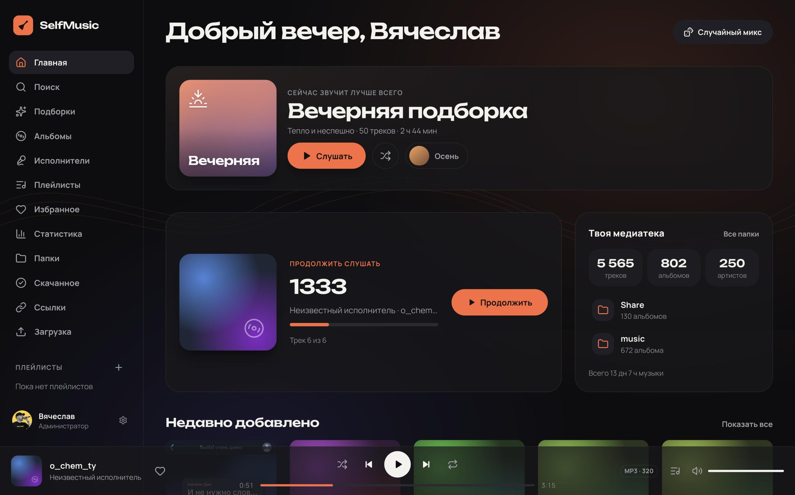

<p align="center">
  
</p>

<h1 align="center">SelfMusic</h1>

<p align="center">
  Self-hosted музыкальный сервер для своей коллекции — современная замена Synology DS Audio.<br>
  Веб-плеер, аудиокниги, умные подборки, загрузка и редактор тегов, Subsonic API и приложение для Android.
</p>

<p align="center">
  
  
  
  
  
</p>

<p align="center">
  
</p>

---

## Содержание

- [Возможности](#возможности)
- [Быстрый старт](#быстрый-старт)
- [Папки с музыкой](#папки-с-музыкой)
- [База данных](#база-данных)
- [Обратный прокси и HTTPS](#обратный-прокси-и-https)
- [Приложения для телефона](#приложения-для-телефона)
- [Переменные окружения](#переменные-окружения)
- [Бэкап](#бэкап)
- [Разработка](#разработка)
- [Стек и структура](#стек-и-структура)
- [Дорожная карта](#дорожная-карта)

## Возможности

### 🎧 Медиатека

- **Несколько папок с музыкой и аудиокнигами** — у каждой свой тип и свои права доступа.
- **Инкрементальное сканирование** — по расписанию и вручную; меняются только изменившиеся файлы.
- **Теги** ID3, FLAC/Vorbis, MP4, APE, WMA (через mutagen).
- **Обложки** из папки (`cover.jpg`, `folder.jpg`…) или встроенные в файл, с кэшем превью.
- **Тексты песен** из тегов или из `.lrc` рядом с треком, синхронная прокрутка в плеере.
- **Многодисковые альбомы** (`Альбом/CD1`, `CD2`) склеиваются в один.
- **Поиск дубликатов** — с учётом «Remaster», «Deluxe», «Radio Edit» и прочих пометок.
- Просмотр по альбомам, исполнителям, папкам; глобальный поиск.

### 🌐 Сведения из интернета (по желанию)

Выключено по умолчанию, включается в «Админка → Общие → Сведения из интернета». Файлы с музыкой не меняются,
найденное хранится в базе и в `data/meta`; свои обложки и теги всегда главнее.

- **Альбомы** — релиз в [MusicBrainz](https://musicbrainz.org): по MBID из тегов (если файлы размечены Picard),
  иначе по названию и исполнителю, иначе по звуку. Даёт **обложку** из Cover Art Archive (если своей нет),
  **год и жанр** (если их нет в тегах).
- **Исполнители** — **биография** из Википедии на выбранном языке и **фото** с Викисклада, годы, страна, жанры.
  Фото заменяет обложку альбома в карточке исполнителя, биография видна на его странице и в Subsonic-клиентах.
- **Распознавание по звуку** ([AcoustID](https://acoustid.org), нужен бесплатный ключ приложения) — для альбомов,
  которые не нашлись по названию, и для треков без тегов: им подставляются название и исполнитель.
- Работает в фоне, по одному объекту, не чаще запроса в секунду (правила MusicBrainz); ненайденное перепроверяется
  через месяц или по кнопке. Ошибся — на странице альбома «Ещё → Сведения из MusicBrainz», на странице исполнителя
  «MusicBrainz»: поиск с выбором из списка, ссылка на релиз или «Не искать».

### ▶️ Веб-плеер

- Очередь, перемешивание, повтор, мини-плеер и полноэкранный режим.
- **Эквалайзер** с пресетами, **кроссфейд** (с опцией «не смешивать внутри альбома»), **воспроизведение без пауз** (gapless).
- **Выравнивание громкости** — по ReplayGain или по результатам собственного анализа, режимы «трек» / «альбом».
- **Радио** — бесконечная волна похожих треков от трека или исполнителя.
- Управление с экрана блокировки и кнопками медиаклавиш (Media Session API).
- Очередь и позиция сохраняются между перезагрузками.
- Тёмная и светлая темы, несколько акцентных цветов, «живой» фон по цвету обложки.
- **PWA** — ставится на телефон и компьютер как приложение.

### ✨ Подборки и статистика

- **Личные миксы** для каждого пользователя:
  - по времени суток — утренняя, дневная, вечерняя, ночная;
  - по настроению — энергия, радость, спокойствие, меланхолия, концентрация, для сна;
  - по сезону — зима, весна, лето, осень;
  - персональные — «Забытое любимое», «Год назад».
- **Анализ звука** — темп, энергия, яркость, лад (мажор/минор) → оси «спокойно ↔ энергично» и «грустно ↔ радостно».
  Работает в фоне с минимальным приоритетом (`nice 19`, `ionice idle`) и только в разрешённые часы (по умолчанию ночью), чтобы не нагружать NAS.
- Учитываются избранное, история, привычное время прослушивания; «Не подходит» навсегда убирает трек из подборки.
- **Умные плейлисты** по правилам и **совместные плейлисты** с участниками.
- **«Итоги»** за неделю, месяц и год в формате историй, любимые исполнители на главной.

### 📚 Аудиокниги

- Отдельный раздел: главы, запоминание места, скорость воспроизведения, закладки, **таймер сна**.

### 👥 Пользователи и права

- **Мастер первого запуска** — выбор базы (SQLite или MariaDB/MySQL), создание администратора, выбор папок, открытая или закрытая регистрация.
- Доступ к каждой папке на **чтение** и **запись** выдаётся отдельно для каждого пользователя, с деревом правил по подпапкам.
- Права действуют везде — в вебе, в поиске, в Subsonic-клиентах и в потоке.
- Аватары с квадратной обрезкой, профиль, «пароль для приложений».
- Защита от перебора паролей, короткоживущие access-токены и refresh-сессии.

### ⬆️ Загрузка и редактор тегов

- Режим загрузки для каждого пользователя: запрещено / только в личную папку / в общие папки с правом записи.
- **Лимиты** по объёму и числу файлов для личной папки.
- Автоматическая раскладка по тегам «Исполнитель / Альбом».
- **Редактор тегов** — для трека или всего альбома сразу, со сменой обложки; изменения пишутся прямо в файлы.

### 🔗 Ссылки «Поделиться»

- На папку, альбом, исполнителя, плейлист или выбранные треки.
- Пароль, срок действия, качество потока, режим «только слушать» или «можно скачать».
- Право делиться включается для каждого пользователя отдельно.

### 📡 Поток, синхронизация, офлайн

- **Транскодирование на лету** через ffmpeg: качество в профиле (оригинал или MP3 320/192/128); APE, WMA, ALAC, DSD и другие неподдерживаемые браузером форматы перекодируются автоматически.
- **Синхронизация между устройствами** — начали слушать на телефоне, компьютер предложит продолжить с того же места.
- **Офлайн** — альбомы и плейлисты скачиваются в браузер или в Android-приложение.

### 📱 Приложение для Android

Гибрид: нативные экран входа и плеер (Expo, `expo-audio`), остальной интерфейс — веб-версия во WebView.
Фоновое воспроизведение, экран блокировки, кнопки наушников, скачивание для офлайна, обновления «по воздуху».
APK раздаётся прямо с сервера. Подробнее — в [mobile/README.md](mobile/README.md).

### 🔌 Subsonic / OpenSubsonic API

Эндпоинт `/rest/*` — подходят готовые клиенты: Symfonium, Tempo, DSub (Android), Amperfy, play:Sub, Substreamer (iOS), Feishin (десктоп).
Поддерживаются скробблинг, избранное, плейлисты и «радио» по похожим трекам.

## Быстрый старт

```bash
git clone https://github.com/kozhevyatov/selfmusic.git
cd selfmusic
docker compose up -d --build
```

Откройте `http://<сервер>:1332` — мастер проведёт через четыре шага:

1. **База данных** — SQLite (файл в `./data`) или MySQL/MariaDB.
2. **Администратор** — логин, пароль, название сервиса, открыта ли регистрация.
3. **Папки с музыкой** — выбираются в обзоре папок внутри `/music`, можно несколько.
4. **Готово** — медиатека сканируется в фоне.

> Без токена мастер первого запуска открывается только из локальной сети. Если настраиваете сервер через интернет, задайте `SETUP_TOKEN` в `.env` — мастер его спросит.

### Готовый образ (Synology Container Manager и без сборки)

Образ собирается автоматически при каждом обновлении и лежит в GitHub Container Registry — собирать ничего не нужно.
Это же решает ошибку Container Manager `unable to find 'git'` при `build:` со ссылкой на GitHub.

```yaml
services:
  selfmusic:
    image: ghcr.io/kozhevyatov/selfmusic:latest
    container_name: selfmusic
    restart: unless-stopped
    ports:
      - "1332:1332"
    environment:
      TZ: Europe/Moscow
    volumes:
      - ./data:/data
      - ./media:/uploads
      - /volume1/music:/music/music:ro
```

Обновление: `docker compose pull && docker compose up -d`.

## Папки с музыкой

Контейнер видит только то, что смонтировано в `docker-compose.yml`. Удобнее всего задать пути в `.env` рядом с ним:

```env
MUSIC_DIR=/volume1/music        # общая музыка → /music/music
BOOKS_DIR=/volume1/audiobooks   # аудиокниги (необязательно) → /music/books
DATA_PATH=./data                # конфиг, ключ, аватары, кэш, база SQLite
MEDIA_PATH=./media              # личные папки пользователей
```

Дополнительные папки — в `docker-compose.override.yml`:

```yaml
services:
  app:
    volumes:
      - /volume1/vinyl:/music/vinyl:ro
```

- **`:ro`** — только чтение: слушать можно, загружать и править теги — нет. Уберите `:ro`, если это нужно.
- **Личные папки** создаются в `media/<логин>/music` и `media/<логин>/books`; при смене логина папка переименовывается сама.
- **Владелец файлов** — чтобы загруженные файлы принадлежали вашему пользователю, а не root, раскомментируйте `user: "UID:GID"` в `docker-compose.yml`.

После добавления папки подключите её в **Админка → Библиотеки** и выберите тип: музыка или аудиокниги.

## База данных

- **SQLite** — файл `data/selfmusic.db`, ничего настраивать не нужно.
- **MariaDB / MySQL** — можно подключиться к уже работающему контейнеру через его Docker-сеть: задайте в `.env` `DB_NETWORK=<имя сети>` и подключите `docker-compose.mariadb.yml`:

  ```bash
  docker compose -f docker-compose.yml -f docker-compose.mariadb.yml up -d --build
  ```

  ```sql
  CREATE DATABASE selfmusic CHARACTER SET utf8mb4 COLLATE utf8mb4_unicode_ci;
  CREATE USER 'selfmusic'@'%' IDENTIFIED BY 'надёжный-пароль';
  GRANT ALL PRIVILEGES ON selfmusic.* TO 'selfmusic'@'%';
  FLUSH PRIVILEGES;
  ```

  В мастере укажите хост — имя контейнера с базой, порт `3306`, базу, логин и пароль.

Миграции схемы применяются автоматически при старте (Alembic).

## Обратный прокси и HTTPS

Подойдёт любой прокси — Nginx Proxy Manager, обратный прокси Synology DSM, Caddy, Traefik:

- назначение — `http://<хост>:1332`;
- включите поддержку **WebSocket**;
- увеличьте лимит размера запроса, если загружаете большие FLAC.

Заголовки `X-Forwarded-*` принимаются только от прокси из локальных сетей (`FORWARDED_ALLOW_IPS`), чтобы нельзя было подделать IP и обойти защиту от перебора паролей.
Внешний адрес сервиса для ссылок «Поделиться» задаётся в **Админке**.

## Приложения для телефона

В Subsonic-клиенте выберите сервер типа Subsonic (или Navidrome) и укажите:

- **адрес** — адрес вашего сервера;
- **логин** — ваш логин;
- **пароль** — «пароль для приложений» из профиля.

Пароль для приложений отдельный от основного: протокол Subsonic передаёт `md5(пароль + соль)`, поэтому серверу нужно хранить его в обратимом (зашифрованном) виде, а основной пароль так не хранится. Простые клиенты, которые шлют пароль открытым текстом, принимают и основной.

Собственное Android-приложение собирается из папки [`mobile/`](mobile/README.md) — готовый APK можно загрузить в **Админка → Приложение для Android**, и сервер будет раздавать его пользователям.

## Переменные окружения

| Переменная | Назначение |
|---|---|
| `DATABASE_URL` | Задать БД заранее и пропустить шаг мастера |
| `SETUP_TOKEN` | Токен для мастера первого запуска |
| `SECRET_KEY` | Ключ JWT и шифрования паролей приложений (иначе генерируется в `/data/secret.key`) |
| `MEDIA_ROOT` | Корень для выбора папок с музыкой, по умолчанию `/music` |
| `UPLOAD_ROOT` | Где создаются личные папки, по умолчанию `/uploads` |
| `ACCESS_TOKEN_MINUTES` | Время жизни access-токена, по умолчанию 15 |
| `REFRESH_TOKEN_DAYS` | Время жизни сессии, по умолчанию 30 |
| `COOKIE_SECURE` | `auto` / `true` / `false` для cookie |
| `MAX_TRANSCODES` | Сколько перекодирований ffmpeg одновременно (для слабых NAS) |
| `COVER_WORKERS` | Сколько потоков обрабатывают обложки |
| `TZ` | Часовой пояс (влияет на подборки по времени суток и ночной анализ) |
| `PORT` | Внутренний порт, по умолчанию 1332 |

## Бэкап

Всё состояние — в `data/` (кроме `data/cache`; `data/meta` — найденные в интернете обложки и фото, их можно скачать заново), `media/` и `.env`; если используется MariaDB — ещё её дамп.
Для SQLite достаточно скопировать `data/` при остановленном контейнере.
Главное в `data/` — `secret.key`: без него все пользователи выйдут из аккаунтов, а пароли для приложений придётся создавать заново.

## Разработка

```bash
# бэкенд
cd backend
python -m venv .venv && source .venv/bin/activate
pip install -r requirements.txt
DATA_DIR=../data MEDIA_ROOT=~/Music UPLOAD_ROOT=../media uvicorn app.main:app --reload --port 1332

# фронтенд (в другом терминале)
cd frontend
npm install
npm run dev        # http://localhost:5173, /api и /rest проксируются на :1332
```

Новая миграция после изменения моделей:

```bash
cd backend && DATA_DIR=../data alembic revision --autogenerate -m "описание"
```

Документация API (Swagger): `http://localhost:1332/docs`.

## Стек и структура

**Бэкенд:** Python · FastAPI · SQLAlchemy 2 · Alembic · mutagen · Pillow · numpy · ffmpeg
**Фронтенд:** React 19 · TypeScript · Vite · Tailwind CSS 4
**Мобильное приложение:** Expo · React Native · expo-audio
Всё упаковано в один Docker-контейнер на порту **1332**.

```
backend/app/
  main.py         приложение, отдача SPA
  db.py           подключение к БД (SQLite / MariaDB), миграции
  models.py       модели SQLAlchemy
  access.py       права на папки, личные папки, лимиты загрузок
  scanner.py      инкрементальный сканер (фоновый, по расписанию)
  tags.py         чтение и запись тегов, встроенные обложки
  media.py        обложки, поток с Range, перекодирование ffmpeg
  analysis.py     анализ звука для подборок (ночью, с низким приоритетом)
  metadata.py     сведения из MusicBrainz, Cover Art Archive, Википедии, AcoustID
  mixes.py        личные миксы и радио
  duplicates.py   поиск дубликатов
  routers/        setup, auth, profile, admin, library, uploads, books,
                  mixes, shares, stats, queue, android, meta, subsonic
frontend/src/
  lib/            api, плеер, эквалайзер и кроссфейд, офлайн, синхронизация, тема
  components/     Layout, Player, TrackList, диалоги, редактор умных плейлистов
  pages/          главная, альбомы, исполнители, папки, книги, миксы, плейлисты,
                  статистика, загрузка, профиль, админка, мастер установки
mobile/           Android-приложение (Expo)
```

## Дорожная карта

- [x] Мастер настройки, пользователи, папки и права, сканер, веб-плеер, Subsonic API, загрузка, редактор тегов, PWA
- [x] Ссылки «Поделиться», аудиокниги, офлайн, миксы
- [x] Умные и совместные плейлисты, дубликаты, «Итоги» и статистика, синхронизация между устройствами
- [x] Приложение для Android
- [x] Обложки, год и жанр, биографии и фото исполнителей из MusicBrainz / Cover Art Archive / Википедии, распознавание по звуку через AcoustID (по желанию, выключено по умолчанию)
- [ ] Chromecast / AirPlay
